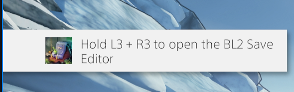
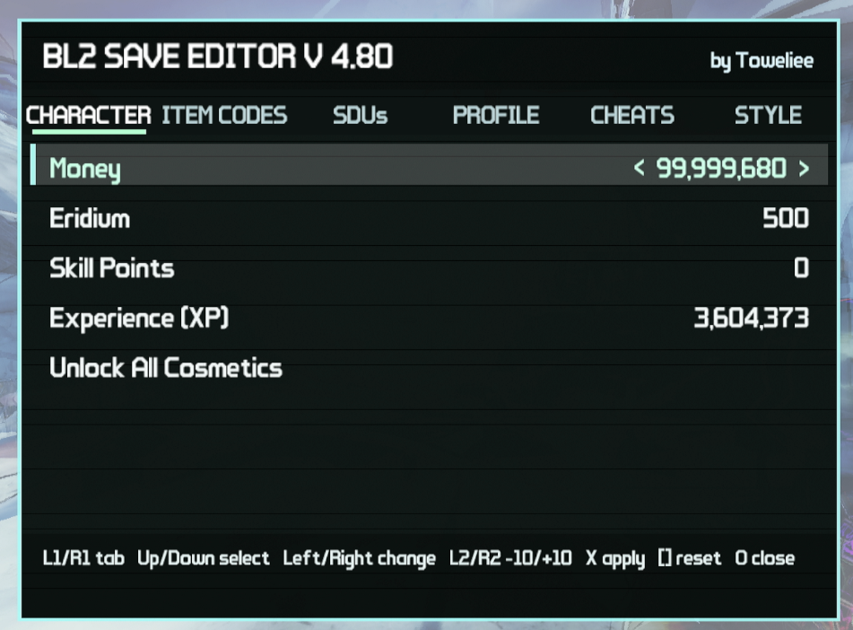
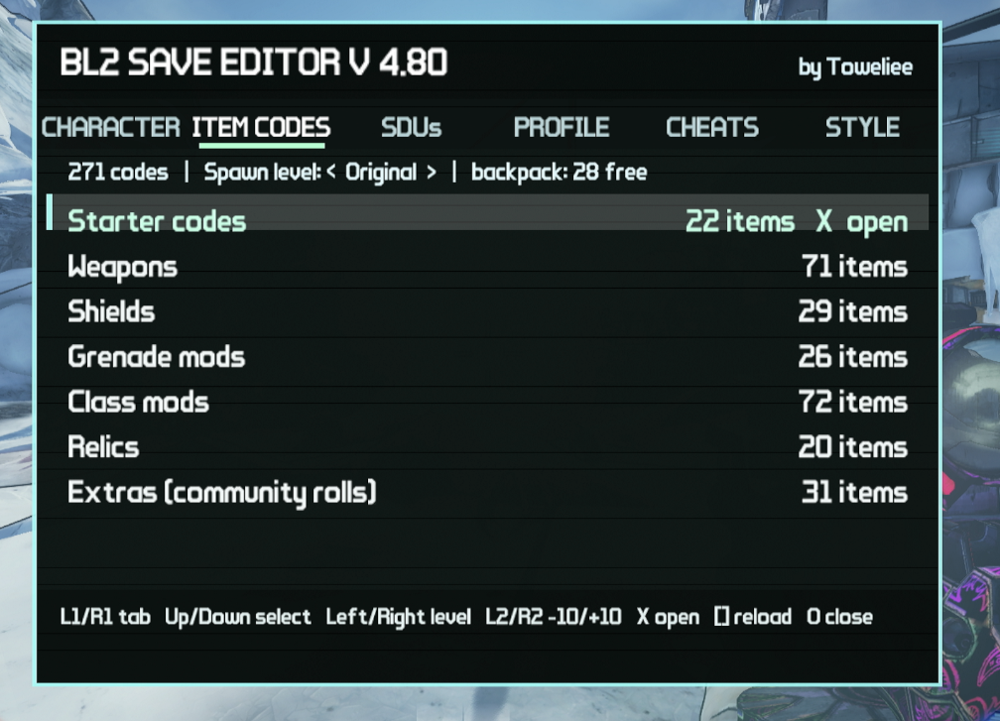
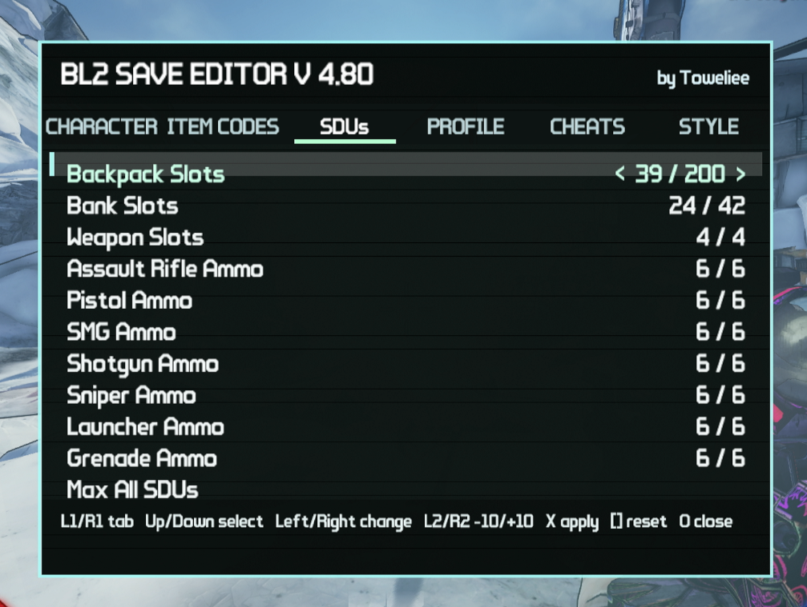
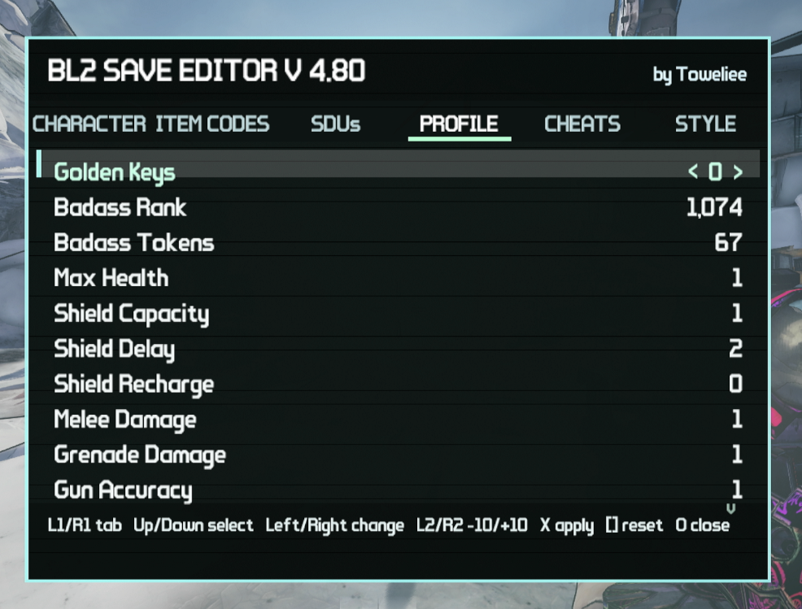
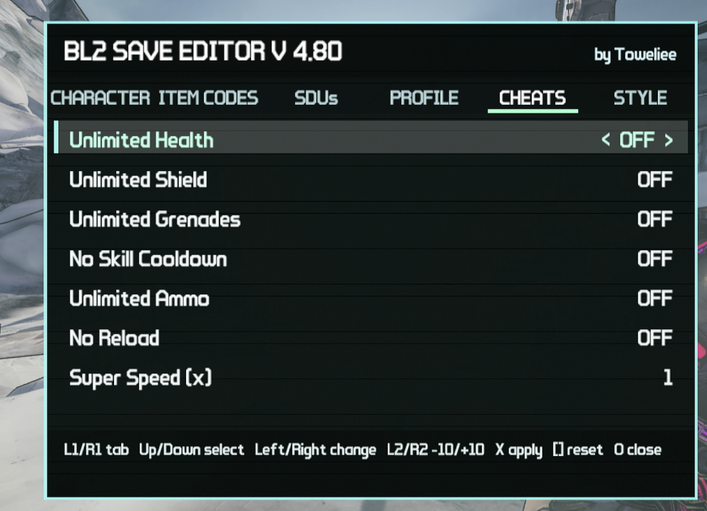
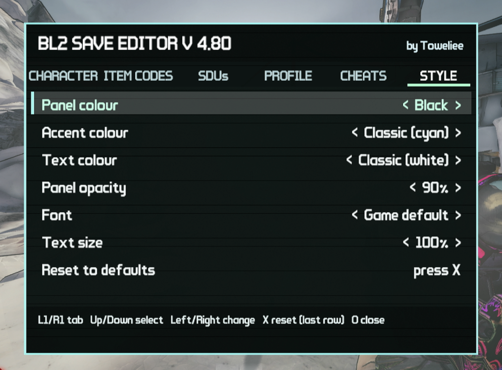

# Borderlands 2 Save Editor (PS4 / GoldHEN)

An in-game save editor plugin for **Borderlands 2** on jailbroken PS4s running **GoldHEN**, by **Toweliee / CLAUDE AI**.
Open it in game, edit your character, spawn items from codes, max out SDUs, turn on cheats, restyle the menu and play a loot randomizer, all without leaving the game.

| | |
|---|---|
| **Game** | Borderlands 2 – The Handsome Collection, **CUSA01401 v1.10** |
| **Tested on** | PS4 firmware **13.02** with GoldHEN |
| **Latest version** | [v5.30](https://github.com/Towelieevr/Borderlands-2-Save-Editor-PS4/releases/latest) |

> Back up your saves before editing (Apollo Save Tool or the PS4's own save backup). Found a problem? Please report it on the [Issues](https://github.com/Towelieevr/Borderlands-2-Save-Editor-PS4/issues) page.

---

## Contents

- [Download & install](#download--install)
- [Opening the editor](#opening-the-editor)
- [Controls](#controls)
- [Tabs](#tabs)
  - [Character](#character)
  - [Item Codes](#item-codes)
  - [SDUs](#sdus)
  - [Profile](#profile)
  - [Cheats](#cheats)
  - [Style](#style)
  - [Rando (Loot Randomizer)](#rando-loot-randomizer)
- [Credits & license](#credits--license)

---

## Download & install

**Easiest:** install it with the [Toweliee's Save Editors](https://github.com/Towelieevr/Toweliee-Save-Editors) app, which also checks for updates online.

**Manual install:**

1. Download the zip from [Releases](https://github.com/Towelieevr/Borderlands-2-Save-Editor-PS4/releases/latest).
2. Copy the `GoldHEN` folder from the zip to `/data/GoldHEN/` on your PS4 over FTP:
   - `bl2_editor.prx` goes in `/data/GoldHEN/plugins/`
   - `bl2_editor_icon.png` and `bl2_codes.txt` go in `/data/GoldHEN/`
3. Add the editor to `/data/GoldHEN/plugins.ini` as shown in the zip's `plugins.ini.txt`:
   ```ini
   [CUSA01401]
   /data/GoldHEN/plugins/bl2_editor.prx
   ```
   If `XeMo.prx` is listed under `[CUSA01401]`, put the editor line **after** it, or the menu won't open.
4. Fully close and restart the game.

---

## Opening the editor

Load into gameplay. A pop-up tells you the editor is ready:

<p align="center"></p>
<p align="center"><em>The in-game hint: hold <b>L3 + R3</b> to open the editor.</em></p>

---

## Controls

| Button | Action |
|---|---|
| **L3 + R3** (hold) | Open / close the editor |
| **L1 / R1** | Previous / next tab |
| **Up / Down** | Select a row |
| **Left / Right** | Change the value |
| **L2 / R2** | Change by -10 / +10 |
| **X** | Apply the change (or run the selected action) |
| **□** | Reset the row to its current in-game value |
| **O** | Close the editor (or go back) |

---

## Tabs

### Character

<p align="center"></p>
<p align="center"><em><b>Character tab:</b> money, Eridium, skill points, experience, and Unlock All Cosmetics.</em></p>

- **Money**, **Eridium**, **Skill Points** and **Experience (XP)**: dial in any value and press **X** to apply.
- **Unlock All Cosmetics**: unlocks every head and skin, saved to your profile.

### Item Codes

<p align="center"></p>
<p align="center"><em><b>Item Codes tab:</b> 271 BL2 item codes in categories, with a spawn-level selector.</em></p>

- Open a category with **X**, then press **X** on an item to spawn it straight into your backpack.
- **Spawn level:** keep the code's *Original* level or pick any level up to 80 with Left/Right.
- The list comes from `/data/GoldHEN/bl2_codes.txt`. Add your own `Name = BL2(...)` lines (any letter case) and press **□** to reload.

### SDUs

<p align="center"></p>
<p align="center"><em><b>SDUs tab:</b> backpack, bank, weapon slots and every ammo SDU, plus Max All SDUs.</em></p>

- **Backpack Slots** go past the game's normal limit of 39, up to **200**. The bigger backpack is kept after saving and reloading (open the editor once after loading to restore it).
- **Bank**, **weapon slots** and all **7 ammo SDUs**, or **Max All SDUs** to max everything to the game's normal limits in one press.

### Profile

<p align="center"></p>
<p align="center"><em><b>Profile tab:</b> golden keys, Badass Rank, Badass Tokens and all 14 Badass bonus stats.</em></p>

- **Golden Keys** (for the current session), **Badass Rank** and **Badass Tokens**.
- All **14 bonus stats**: max health, shield capacity, delay and recharge, melee, grenade, gun accuracy, damage and fire rate, recoil, reload, elemental chance and damage, and critical hit damage. The list scrolls.

### Cheats

<p align="center"></p>
<p align="center"><em><b>Cheats tab:</b> toggle cheats on and off while you play.</em></p>

- **Unlimited Health**, **Unlimited Shield**, **Unlimited Grenades**, **No Skill Cooldown**, **Unlimited Ammo** and **No Reload**.
- **Super Speed:** 1x to 6x movement speed (affects only you).
- Cheats keep working through fast travel and level changes, and pause while you drive a vehicle.

### Style

<p align="center"></p>
<p align="center"><em><b>Style tab:</b> customize how the editor looks.</em></p>

- **Panel**, **accent** and **text colour** (15 colours or Classic), **panel opacity**, **font** (any font the game has loaded) and **text size**.
- Your style is saved and kept between sessions. **Reset to defaults** brings back the classic look.

### Rando (Loot Randomizer)

A PS4 port of **[mopioid's Loot Randomizer](https://github.com/mopioid/Borderlands-Loot-Randomizer)** for the PC version of Borderlands 2, used with mopioid's permission. Unique enemies and missions each drop an item picked by your seed. The same seed gives the same items as the PC mod.

- **Randomizer:** turn it on or off. The first time, it makes a new seed for you.
- **Seed** / **New random seed:** shows your seed, or rolls a new one. Seeds work like PC seeds, so you can share them.
- **Reload bl2_rando.ini:** loads a seed you typed into `/data/GoldHEN/bl2_rando.ini` (for example `seed=xxxxx-xxxxx-xxxxx`).
- **Guaranteed drops (test):** every drop roll succeeds. This is for testing and isn't in the PC mod.
- **Every enemy drops:** Off / 5% / 10% / 25% / 50% / 100%. Every enemy, bosses included, gets that chance to also drop a random item from the randomizer's pools. This isn't in the PC mod.
- **Content options** (DLCs, mission lengths, enemy types and so on) apply to the next new seed.
- Open the editor once after loading in to start the randomizer. Missions give their item straight to your backpack.

Not ported yet: hints, "other" locations, a few non-Pawn enemies, and repeatable missions.

---

## Credits & license

Made by **Toweliee / CLAUDE AI**.

**Thanks to:**

- **[mopioid](https://github.com/mopioid)** for the original **[Borderlands Loot Randomizer](https://github.com/mopioid/Borderlands-Loot-Randomizer)**. The RANDO tab's item and location tables are generated from Loot Randomizer's data, and its seed logic is rebuilt from it. It's used with mopioid's permission. If you enjoy the randomizer, check out the original and [tip mopioid](https://streamlabs.com/mopioid/tip), or join the [Loot Randomizer Discord](https://discord.gg/C37HvmvBbS).
- **[GoldHEN](https://github.com/GoldHEN)** for GoldHEN, the [GoldHEN Plugins SDK](https://github.com/GoldHEN/GoldHEN_Plugins_SDK) (MIT) and the [GoldHEN Plugins Repository](https://github.com/GoldHEN/GoldHEN_Plugins_Repository) (GPL-3.0), whose `plugin_common` code is built into the plugin.
- **[OSM](https://github.com/OSM-Made/PS4-Notify)** for the PS4 notification code used by `plugin_common`.
- **Makoto Matsumoto and Takuji Nishimura** for the Mersenne Twister, and the **Python Software Foundation** for CPython's `random` module, which the seed engine reproduces so that seeds match the PC mod.
- **Gibbed** for the Borderlands 2 save editor and its item code format, and **lootlemon.com**, **gamertweak.com**, **gameplay.tips** and **windowsreport.com** for the item codes in `bl2_codes.txt`.

Full license texts are in [THIRD_PARTY_NOTICES.md](THIRD_PARTY_NOTICES.md).

Free to use and to modify. All I ask is that you give some credit, or don't; it's up to you.
*(The LICENSE file is an old draft; the terms above are the ones that apply.)*

Advice and suggestions are always welcome. Thank you for your patience and support!
